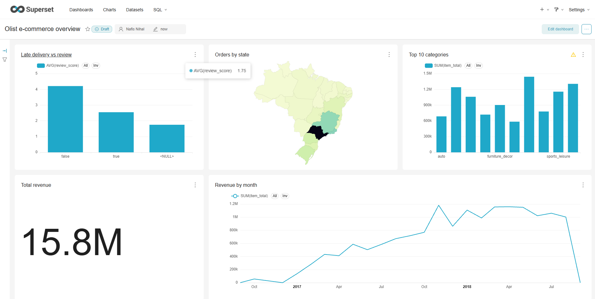
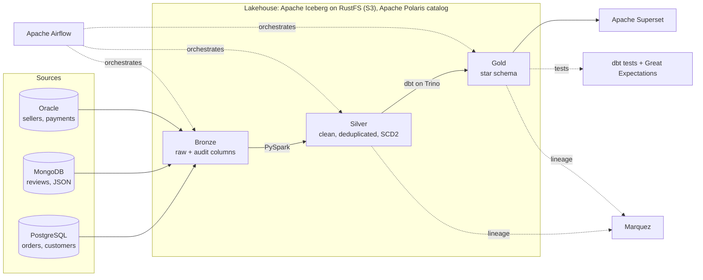

# E-commerce Lakehouse: batch data platform on Apache Iceberg

An end-to-end data platform that ingests an e-commerce company's data from **three different databases**, refines it through **Bronze → Silver → Gold** layers on **Apache Iceberg**, models it as a **star schema**, tests it, tracks its lineage, and serves it to a **dashboard**: orchestrated by **Airflow** and runnable on **Kubernetes**. Everything runs locally with free, open-source tools.



**Key finding:** late deliveries cost customer satisfaction. On-time orders average **4.21** review stars; late orders average **2.55**, a drop of 1.7 stars. Orders that never arrived average **1.75**.

---

## What it does

- **Ingests** about 100,000 real orders (the public [Olist Brazilian e-commerce dataset](https://www.kaggle.com/datasets/olistbr/brazilian-ecommerce)) from PostgreSQL, Oracle and MongoDB with PySpark.
- **Refines** the data in three layers: raw copies with audit columns (Bronze), cleaned and typed tables with customer history (Silver), and a dimensional model for analytics (Gold).
- **Models** a star schema with dbt on Trino: 2 fact tables and 4 dimensions with a documented grain.
- **Guards** quality with 16 dbt tests and a Great Expectations suite that acts as a pipeline gate.
- **Tracks lineage** from source tables to Gold with OpenLineage and Marquez.
- **Orchestrates** everything with an Airflow DAG (retries, quality gate) and runs the Spark jobs as Kubernetes pods.

## Architecture



## Tech stack

| Area | Tools |
| --- | --- |
| Languages | Python (PySpark), Scala, SQL, Bash |
| Processing | Apache Spark 3.5 |
| Storage and table format | RustFS (S3-compatible), Apache Iceberg, Parquet |
| Catalog | Apache Polaris (Iceberg REST catalog) |
| Sources | PostgreSQL, Oracle Database Free, MongoDB |
| Transformation | dbt, Trino |
| Data quality | dbt tests, Great Expectations |
| Lineage | OpenLineage, Marquez |
| Orchestration | Apache Airflow 3 |
| BI | Apache Superset |
| Infrastructure | Docker Compose, Kubernetes (kind), Helm |

## Data model

| Table | Grain | Notes |
| --- | --- | --- |
| `fct_order_items` | one row per item in an order | price, freight, delivery status, review score |
| `fct_payments` | one row per payment | orders can be paid in several parts |
| `dim_customer` | one row per customer | current version from the SCD Type 2 history |
| `dim_product` | one row per product | English category names |
| `dim_seller` | one row per seller | |
| `dim_date` | one row per day, 2016–2018 | `date_key` like `20180115` |

## How to run

**Prerequisites:** Docker Desktop, WSL2 or Linux, Python 3.12, Java 17, about 10 GB of RAM for the full stack.

```bash
git clone https://github.com/pensive-aristocrat/ecommerce-lakehouse.git
cd ecommerce-lakehouse
python3 -m venv .venv && source .venv/bin/activate
pip install -r requirements.txt

# 1. Download the Olist CSVs from Kaggle into data/raw/, then load the source databases
./scripts/sources_up.sh
python scripts/load_sources.py

# 2. Start the lakehouse and rebuild every layer (Bronze, Silver, Gold, quality checks)
./scripts/start_all.sh

# 3. Optional services
./scripts/lineage_up.sh     # Marquez: http://localhost:3000
./scripts/bi_up.sh          # Superset: http://localhost:8088
./scripts/airflow_up.sh     # Airflow: http://localhost:8085
```

To run the Spark jobs on Kubernetes instead, see `k8s/` and `scripts/k8s_run_pipeline.sh`.

## Project structure

```
├── airflow/dags/          Airflow DAG for the laptop (BashOperator)
├── airflow/k8s_dags/      Airflow DAG for Kubernetes (KubernetesPodOperator) + pod template
├── dbt/                   Gold star schema, sources and tests
├── docker/                Docker Compose files and custom images (Superset, pipeline)
├── k8s/                   Kubernetes Jobs, ConfigMap and Airflow Helm values
├── scala_jobs/            Scala Spark job (typed Dataset), built with sbt
├── scripts/               Start-up, loading and validation scripts
└── spark_jobs/            PySpark Bronze and Silver jobs
```

## Design decisions

- **Append-only Bronze.** Each run appends a new batch with `_batch_id`, `_source_system` and `_ingested_at`. Bronze keeps every snapshot; Silver reads only the newest batch.
- **SCD Type 2 for customers.** A row hash detects changes; `MERGE INTO` closes the old row and a second step inserts the new version.
- **Grain first.** Review scores are averaged per order *before* joining to order items, so orders with several reviews cannot inflate revenue.
- **`payment_type = 'not_defined'` is a warning, not an error.** The rows are real payments; dropping them would understate revenue, while a warning keeps them visible on every run.
- **RustFS instead of MinIO.** MinIO's community edition was archived in 2026; RustFS is an actively maintained S3-compatible alternative.
- **A rebuildable lakehouse.** The local Polaris catalog keeps metadata in memory, so one command rebuilds every layer from the sources. The sources, dashboards and lineage history persist in their own Docker volumes.
- **Trino uses static storage keys.** With credential vending on, Trino could read but not create tables, because a table that does not exist yet has no credentials to vend.
- **A sidecar for storage access on Kubernetes.** The catalog tells clients that storage is at `localhost:9000`. A small `socat` sidecar makes that address work inside each pod.
- **Separate Python environments.** Airflow has its own environment; its tasks call the project's environment, so their dependencies never conflict.

## What I would change in production

- A persistent Polaris catalog backed by PostgreSQL, and object storage on AWS S3 (or similar).
- Incremental extraction with change data capture instead of full snapshots (see my CDC streaming project).
- Secrets from a secrets manager instead of local files; a static API secret key for Airflow.
- Airflow with the KubernetesExecutor or CeleryExecutor and an external database.
- CI on every pull request: lint, `dbt build` on a sample, and the Great Expectations suite.

## Lessons learned

- A full C: drive made Docker fail with segmentation faults and "device busy" errors; `df -h` found the cause in seconds.
- Two Docker Compose files in one folder share a project name, so resetting one deleted the other's network. Fixed with explicit `-p` project names.
- Reading and writing Iceberg tables use different credential paths; that is why Trino needed its own keys.
- Kubernetes pods see `localhost` as themselves; a native sidecar fixed the storage address without changing any code.
- Sizing matters: the full stack needs about 10 GB of RAM. Requests and limits, and an `OOMKilled` test, made memory visible.

## Author

**Nafis Sadik Nihal** · [LinkedIn](https://www.linkedin.com/in/nafis-sadik-nihal-575849205/) · [GitHub](https://github.com/pensive-aristocrat)
